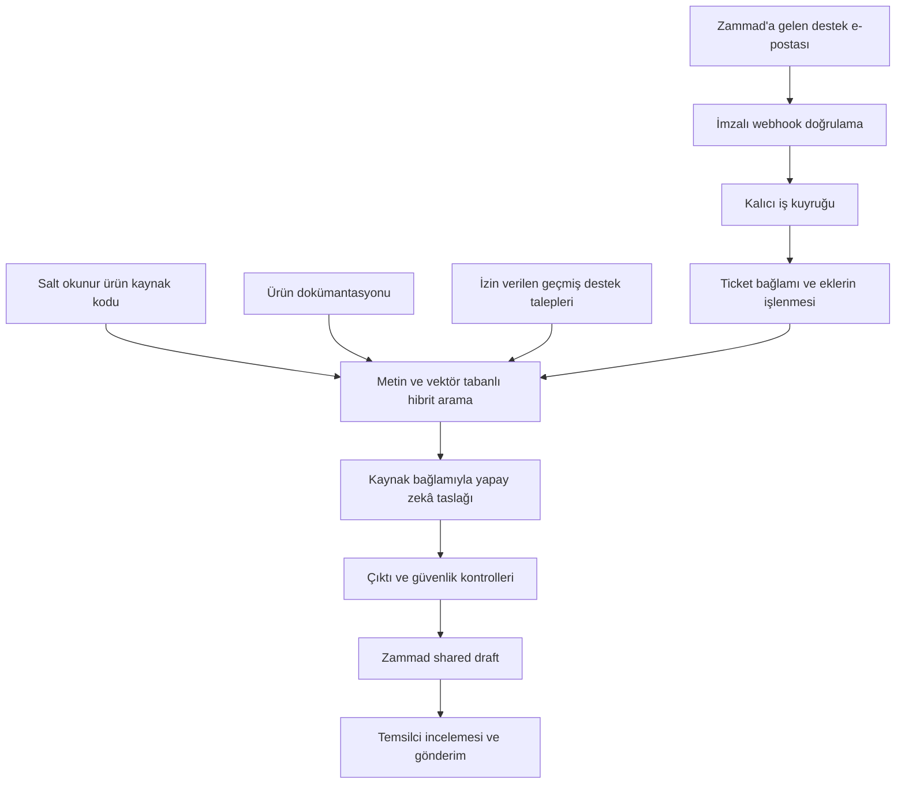

# Zammad AI Support

### Staj Projesi · Yapay Zekâ Destekli Müşteri Destek Asistanı

**Zammad'a gelen destek taleplerini kaynak kodu, dokümantasyon ve geçmiş talepler üzerinden araştırarak destek temsilcisine cevap taslağı hazırlayan bir backend projesi.**

Bu projeyi staj çalışmam kapsamında geliştirdim. Amacım, yapay zekâyı mevcut bir destek sistemine entegre ederken bilgiye erişim, güvenilir cevap üretimi, servis entegrasyonu ve insan kontrolünü birlikte ele almaktı.

> Bu depo projenin portföy / showcase sunumudur. Uygulama kaynak kodu, kurum içi dokümanlar, müşteri verileri ve erişim bilgileri bu depoda paylaşılmaz.

## Çözdüğü problem

Bir destek talebini yanıtlamak çoğu zaman yalnızca bir cevap yazmaktan ibaret değildir. Temsilcinin ürünün nasıl çalıştığını kaynak kodundan kontrol etmesi, ilgili belgeleri incelemesi ve benzer geçmiş talepleri bulması gerekir.

Zammad AI Support bu araştırmayı bir servis akışına dönüştürür. İlgili kaynakları bulur, bunlara dayalı bir cevap önerisi oluşturur ve Zammad'ın **shared draft** alanına kaydeder. Temsilci taslağı inceleyip düzenler ve gönderme kararını verir.

## Nasıl çalışır?

## Öne çıkan özellikler

- **Kaynaklara dayalı cevap hazırlama:** Ürün kodu, belgeler ve izinli geçmiş taleplerden getirilen bağlamla RAG yaklaşımı.
- **Hibrit arama:** Metin araması ile PostgreSQL / pgvector üzerinden anlamsal aramanın birlikte kullanılması.
- **Zammad entegrasyonu:** Webhook ile olay alımı; REST API ile konuşma bağlamı, paylaşılan taslak, öncelik ve etiket yönetimi.
- **Kalıcı ve kontrollü işleme:** PostgreSQL tabanlı iş kuyruğu, aynı olayın tekrar işlenmesini önleyen idempotency kontrolleri ve sınırlı yeniden deneme.
- **Belge ve ek işleme:** PDF, DOCX, XLSX ve metin dosyalarından içerik çıkarma; taranmış PDF ve ekran görüntülerinde Türkçe / İngilizce OCR.
- **Sağlayıcı esnekliği:** OpenAI Responses, Anthropic Messages ve OpenAI uyumlu Chat Completions adaptörleri; dış model çağrısı gerektirmeyen stub modu.
- **İzlenebilirlik:** İş durumu, kullanılan kaynaklar, model çağrıları, token kullanımı ve hata sonuçları için denetim kayıtları ve metrikler.
- **İnsan geri bildirimi:** Taslakların kabul, düzenleme veya ret sonucuyla değerlendirilmesi.

## Teknolojiler

- **Backend:** Java 21, Spring Boot, Maven
- **Veri ve arama:** PostgreSQL, pgvector, Spring Data JPA, Flyway
- **Entegrasyon:** Zammad REST API, HMAC doğrulamalı webhook
- **Yapay zekâ:** RAG, embeddings, yapılandırılmış model çıktıları, sağlayıcı adaptörleri
- **Belge işleme:** Apache Tika, OCR
- **Altyapı:** Docker, Docker Compose
- **Gözlemlenebilirlik:** Spring Boot Actuator, Micrometer
- **Test araçları:** JUnit, WireMock, Testcontainers

## Güvenlik ve insan kontrolü

Projenin temel tasarım kararı, son kararın destek temsilcisinde kalmasıdır.

- Servis müşteriye otomatik cevap göndermez; cevap shared draft olarak hazırlanır.
- Mevcut insan taslağının üzerine yazılmaz ve mevcut yüksek öncelik düşürülmez.
- Kaynak kodu ve dokümanlar salt okunur bağlanır.
- Kaynak, ticket ve ek içerikleri için hassas veri temizleme kontrolleri uygulanır; bu kontroller tüm hassas verilerin kusursuz tespit edildiği anlamına gelmez.
- Çalıştırılabilir dosyalar ve arşiv ekleri reddedilir; dosya türü ve boyutu denetlenir.
- Yönetim endpoint'leri korunur; iş kabul limitleri ve sınırlı retry politikaları kullanılır.
- Kaynaklar yetersiz olduğunda ek bilgi isteme veya insan incelemesine yönlendirme yaklaşımı benimsenir.

## Staj kapsamında çalıştığım alanlar

Bu çalışma, bir model çağrısını mevcut uygulama süreçleriyle güvenilir biçimde birleştirmeye odaklandı:

- Spring Boot ile bağımsız bir backend servisinin geliştirilmesi.
- Zammad olaylarının alınması ve REST API entegrasyonu.
- Kaynak kodu, dokümantasyon ve geçmiş talepler için indeksleme ve retrieval akışları.
- Model sağlayıcılarının yapılandırılabilir adaptörlerle ayrılması.
- Kalıcı kuyruk, hata yönetimi, idempotency ve audit mekanizmaları.
- Belge / OCR işleme ve veri temizleme kontrolleri.
- Birim, entegrasyon ve kontrollü uçtan uca test senaryoları.

## Doğrulama yaklaşımı ve mevcut kapsam

Proje yerel Docker ortamında geliştirilmiş ve kontrollü Zammad senaryolarıyla denenmiştir. Test kapsamı; webhook doğrulaması, tekrar gelen olaylar, veri tabanı davranışları, Zammad API sözleşmeleri, mevcut taslağın korunması ve kaynak seçimi gibi alanları içerir.

Bu tanıtım, güncel bir test koşusu veya üretim başarı oranı raporu değildir. Yerel pilot sonuçları bütün müşteri sorularında doğruluk garantisi vermez; oluşturulan taslaklar insan incelemesi gerektirir. Sağlayıcı adaptörlerinin bulunması da her sağlayıcının canlı ortamda doğrulandığı anlamına gelmez.

## Depo hakkında

Bu repo uygulamanın kurulabilir dağıtımını değil, staj projesinin amacını, mimarisini ve teknik kapsamını sunar. Şirket adı, gerçek destek yazışmaları ve özel kaynak dosyaları paylaşılmamıştır.

**Geliştiren:** [Ertuğrul Ünal](https://github.com/unalertu)

Bu çalışma bağımsız bir staj projesidir; resmî bir Zammad ürünü değildir.
